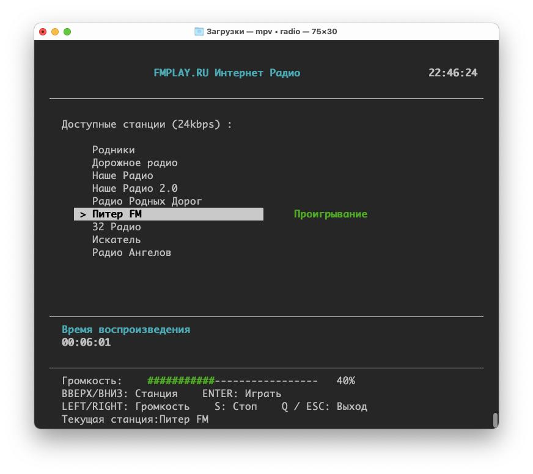

## Russian Internet Radio Player (fmplay.ru)

A lightweight very stable and reliable console internet radio player written in C using ncurses and mpv.
Plays stations with 24kbps/s aac-he-v2 bitrate.

## Screenshots
- Debian

- MacOS


## Requirements

- GCC
- ncursesw
- mpv
- ALSA

## Compilation & Running (Debian / Ubuntu)

```bash
sudo apt-get update
sudo apt install wget build-essential libncurses-dev mpv
wget https://raw.githubusercontent.com/nallion/FMPLAY-linux/refs/heads/main/radio.c
gcc -D_DEFAULT_SOURCE -O2 -Wall -Wextra radio.c -o radio -lncursesw
./radio
```

## Downloading & Running builded binary (Debian / Ubuntu)

```bash
sudo apt-get update
sudo apt install wget libncursesw6 mpv
wget "https://github.com/nallion/FMPLAY-linux/releases/download/Latest-1/radio"
chmod 777 radio
chmod +X radio
./radio
```

Project written with ChatGPT
