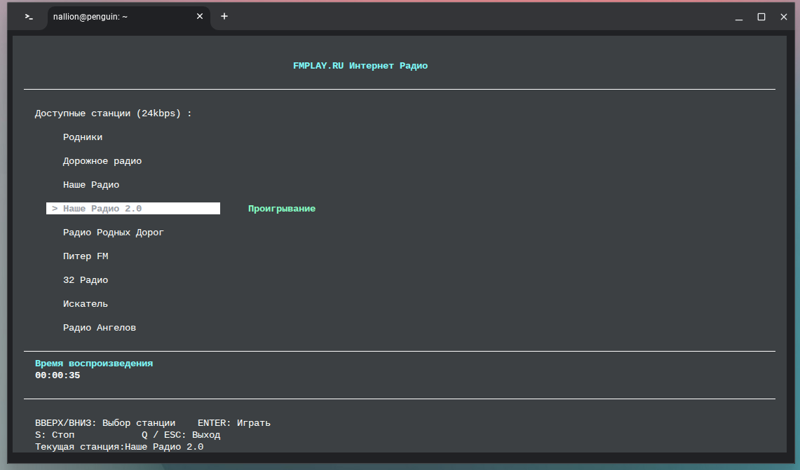

## Russian Internet Radio Player (fmplay.ru)

A lightweight internet radio player written in C using ncurses and mpv.

## Screenshot



## Requirements

- GCC
- ncursesw
- mpv
- ALSA

## Compilation

```bash
sudo apt install build-essential libncurses-dev mpv
gcc -D_DEFAULT_SOURCE -O2 -Wall -Wextra radio.c -o radio -lncursesw
```
or run compile.sh

Project written with ChatGPT
